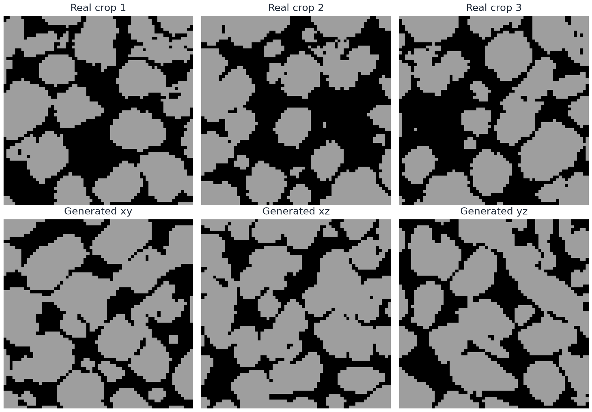
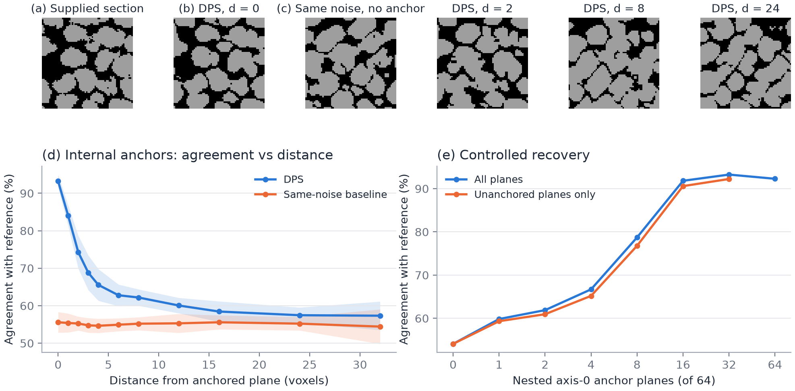

  <h1>Generating 3D Microstructures from 2D Sections with a Two-Stage Diffusion-GAN</h1>

## Abstract

We present a two-stage diffusion-GAN that learns 3D categorical microstructures from unregistered 2D sections: a low-resolution (LR) stage generates the 3D arrangement, and a super-resolution (SR) stage refines it. This document reports the LR stage; the SR stage is still training. The LR denoiser is trained only through 2D critics, together with losses that make the three axes of each volume agree and mirrored diagonal statistics balance. Because no 3D data exist, the exported step is chosen by a section-structure score normalized by the real data's own sampling noise; the chosen step is also best on independent crops. Generated volumes match the real interface density within 2.5% and percolate in both phases, but undershoot the pore fraction and show anisotropic tortuosity. Supplied planes are applied at inference by diffusion posterior sampling without anchor-specific training: a plane is reproduced with about 90% voxel agreement and no seam, and sixteen planes recover 91.8% of a known volume. These are controlled generation results, not 3D reconstruction accuracy. Code, settings, and evaluation scripts are available at https://github.com/phykn/diffusion-gan3d.

## 1. Introduction

Three-dimensional connectivity controls many transport and mechanical properties, but 3D scans are harder to obtain than 2D micrographs. SliceGAN [3] showed that a volumetric generator can be learned from 2D images alone by judging its sections with 2D critics. Two problems remain. Section realism is a weak constraint on the volume: a generator can keep every section plausible while choosing an unrealistic 3D arrangement, for example by shearing structure so that only one section plane degrades. And adversarial training on a single small image drifts: critics eventually memorize the data, so the last step is often not the best one.

We address these problems in a two-stage system and describe its LR stage here. The contributions are:

1. a 3D denoising-diffusion GAN [14,15] trained only with 2D critics on pairs of adjacent diffusion states, using the relativistic loss and burn-in of R3GAN [16];
2. losses that encode what 2D sections cannot reveal: agreement of statistics between the three axes of each volume, and balance between mirrored diagonals, which removes shear;
3. checkpoint selection by a section-structure score computed from 2D data only; and
4. plane anchors applied at inference by diffusion posterior sampling (DPS) [17] on an unconditional model.

## 2. Related Work

Feature-matching and conditional neural methods reconstruct 3D microstructures from a 2D exemplar [1,2], and SliceGAN removes paired 3D supervision with 2D discriminators [3]. Diffusion models have since been used for 2D-to-3D expansion [4,5,6], property-conditioned methods control phase fraction or spatial statistics [7,8], and volumetrically supervised methods reconstruct from sparse or surface slices [9,10,11]. Our setting has only unregistered 2D sections and asks for plausible realizations, not a unique reconstruction.

Diffusion inpainting preserves observed regions while generating their surroundings [12,13]. DPS [17] instead steers an unconditional model with the gradient of a measurement error on its clean prediction, so no observation-specific training is needed; our anchors use it with a plane mask as the measurement.

## 3. Method

### 3.1 Two-stage resolution

The data are categorical 2D sections normal to each axis, which need not be registered. We learn 3D label volumes whose sections match these 2D distributions, and optionally accept known planes at inference. Each training crop is area-downsampled by two for the LR stage, so one LR voxel spans two source pixels. The SR stage refines frozen LR volumes back to the source resolution. The LR model thus sees a large field of view and learns the arrangement of particles, while the SR model only adds boundary detail consistent with it.

### 3.2 LR denoiser and pair critics

The forward process is a variance-preserving diffusion on one-hot phases with ten transitions. A 3D U-Net receives the noisy state, the transition index, and a fresh latent vector, and predicts phase logits; their softmax is the clean prediction $\hat x_0$, which defines one Gaussian posterior step, as in denoising diffusion GANs [15].

Each training step generates one volume up to a random transition $t$ and cuts sections normal to every axis from the pair $(x_t,x_{t+1})$. A 2D critic scores the two sections together, $D(x_t,x_{t+1},t)$, at three scales; real pairs come from noising real crops. Because the material is isotropic, one critic serves all planes, and every pair receives a random flip or 90° rotation. The critic is trained with the relativistic pairing loss of R3GAN [16],

$$
\mathcal{L}_D=\mathbb{E}\big[\log(1+e^{D(\tilde x)-D(x)})\big],
$$

with each generated pair $\tilde x$ matched to a real pair $x$, plus zero-centered gradient penalties on both real and generated inputs. Scoring pairs rather than single samples removes the optimum in which the generator reproduces only one of several particle orientations present in the data. A burn-in schedule lowers the learning rates and penalties and lengthens the EMA over the first half of training [16].

### 3.3 Statistical losses on the clean volume

Critics judge sections one at a time. Four further terms act on the predicted phase probabilities of the whole volume.

- **Phase fraction** matches the volume's mean phase fractions to those of a real crop.
- **Real transitions** match the joint distribution of phases at short in-plane gaps to that of real crops, a direct low-variance signal on correlation length.
- **Axis agreement** requires the same phase-pair statistics along all three axes of each volume. Unlike the critic, it compares directions inside one volume, so an anisotropic volume cannot pass by being realistic plane by plane.
- **Mirror balance** targets shear. A structure such as $f(y,x-z)$ keeps xy and yz sections realistic and turns only xz sections into stripes, which axis-aligned statistics cannot see. For each coordinate plane and diagonal offset $(a,b)$, the loss compares the phase-pair table $P$ at $(+a,+b)$ with its mirror at $(+a,-b)$:

$$
\mathcal{L}_{\mathrm{mirror}}=\mathbb{E}_{\text{plane},(a,b)}\Big[\max\big(0,\;\tfrac12\lVert P_{+a,+b}-P_{+a,-b}\rVert_1-\epsilon\big)\Big].
$$

### 3.4 Checkpoint selection from 2D statistics

At regular intervals the EMA generator produces volumes from fixed seeds, and their sections are compared with fixed real crops by three statistics: two-point correlation, chord-length distribution, and cluster density and size per phase. Each error is divided by the same error between two halves of the real crops, so 1 means "as far from the data as the data is from itself"; the normalized errors are averaged into one score, and the lowest-scoring step is exported. Cluster statistics are included because merged pores and fragmented solid can match both two-point and chord statistics while changing 3D connectivity.

### 3.5 Plane anchors by posterior sampling

The denoiser is trained without any anchor condition. At inference, an anchor with values $y$ on mask $M$ steers each reverse step by DPS [17]:

$$
x_t\leftarrow x_t-\frac{s}{\mathrm{RMS}}\,\nabla_{x_{t+1}}\big\lVert M\odot(\hat x_0(x_{t+1})-y)\big\rVert^2,
$$

where RMS is the root-mean-square anchor error, so the step does not depend on how much anchor area a volume holds. The gradient flows through the whole denoiser and moves the entire noisy state, so neighboring sections are pulled toward a structure compatible with the anchor instead of meeting it at a seam. Nothing is clamped or pasted; the anchored plane itself is generated.

## 4. Experimental Setup

The training data are one 226 × 690 binary image, with phase 0 as pore and phase 1 as solid. Its provenance and physical pixel size are unknown, so results are in voxels. Random 128² crops, downsampled to 64² on the LR grid, supervise all three axes under an isotropy assumption. Training ran for 10,000 steps (90 minutes on one Apple-silicon GPU), with the burn-in over the first 5000.

  

<em>Figure 1. Binary training image. Orange boxes are example 128² crops; the middle one is the external anchor of Section 5.3. Black: phase 0; gray: phase 1.</em>

**Structure.** Each evaluated checkpoint generates 16 unconditional 64³ volumes, compared with 128 real crops that were not used for selection. The structure score is the selection score of Section 3.4 on these crops. For the selected step we also report percolation (fraction of a phase in components spanning an axis), pore tortuosity along each axis [18], and the tilt balance of solid particles (fraction tilted one way minus the other).

**Anchors.** Each anchored sample is compared with a same-noise baseline, the same seed without guidance. *Internal anchors* take the center plane of an unconditional reference volume along each axis (24 cases); since the reference is known in 3D, agreement can be measured at every distance from the plane. *External anchors* use the real crop of Figure 1 at the center or the boundary of the volume (8 cases each). *Controlled recovery* anchors a growing, nested set of planes from a reference volume (4 cases). *Pool4* is the agreement of 4 × 4-cell phase fractions, which tolerates small boundary shifts. *First change* is the label-change rate next to the anchor divided by the ordinary rate between adjacent sections; above 1 indicates a seam. *Flicker* is the 95th percentile of the change in adjacent-section change rate, relative to the baseline.

## 5. LR Results

### 5.1 Training and checkpoint selection

The selection score falls during burn-in and reaches its minimum at step 8500, then rises (Figure 2a). Its components move in different directions: cluster error falls by a factor of five, while two-point error rises after step 3000 (Figure 2b). The critic logits explain the late rise: after burn-in, scores of real pairs keep climbing while generated pairs stay flat (Figure 2c), the signature of a critic memorizing the one training image.

<em>Figure 2. LR training. (a) Selection score; lower is better. (b) Its components, each divided by the real half-split error. (c) Mean critic logit of real and generated pairs. Gray: burn-in. Dashed: selected step 8500.</em>

On independent crops (Table 1) the ranking holds: step 8500 scores 4.5% below the last step and 23% below the end of burn-in, so selecting by score matters even within one run. Its two-point error is mostly a phase-fraction offset: a pore fraction of 0.342 against 0.367 alone shifts the two-point curves by about 0.02 of the 0.028 observed. The pore fraction falls in the same steps in which cluster error improves, suggesting the generator traded a little pore volume for better-separated particles.

| Step | Structure ↓ | Two-point | Chord | Cluster | Pore fraction | Interface density |
|---|---:|---:|---:|---:|---:|---:|
| Real crops | — | — | — | — | 0.367 ± 0.050 | 0.1227 ± 0.0071 |
| 2500 | 7.64 | 0.0136 | 0.0864 | 0.577 | 0.382 ± 0.005 | 0.1202 ± 0.0016 |
| 5000 | 5.71 | 0.0168 | 0.0850 | 0.352 | 0.353 ± 0.005 | 0.1170 ± 0.0019 |
| 7500 | 4.61 | 0.0273 | 0.0761 | 0.175 | 0.342 ± 0.007 | 0.1191 ± 0.0016 |
| **8500 (selected)** | **4.41** | 0.0282 | 0.0765 | 0.146 | 0.342 ± 0.007 | 0.1197 ± 0.0014 |
| 10000 (last) | 4.62 | 0.0262 | 0.0822 | 0.173 | 0.344 ± 0.007 | 0.1192 ± 0.0016 |

<em>Table 1. Section errors of 16 volumes per step against independent real crops. Real values vary over crops; generated values over volumes.</em>

### 5.2 Unconditional volumes

The sections of the selected step reproduce rounded solid particles separated by a connected pore network (Figures 3 and 4), and the interface density matches the real crops within 2.5%. Both phases percolate along every axis (99.8% of pore and 98.5% of solid voxels lie in spanning components). Two properties remain off. The pore tortuosity differs by axis, 2.23 ± 0.07, 2.62 ± 0.18, and 2.03 ± 0.09 along z, y, and x, and solid particles keep a slight preferred tilt in the xy plane (balance −0.17). The axis and mirror losses act on statistics over a few voxels, whereas tortuosity integrates connectivity over the whole volume, so this anisotropy lies at a scale those losses do not reach.

<em>Figure 3. Unconditional 64³ LR sample at step 8500 with one octant removed.</em>

<em>Figure 4. Top: real crops on the LR grid. Bottom: center sections of the volume in Figure 3.</em>

### 5.3 Plane anchors

DPS raises agreement on the anchored plane from about 55% without guidance to 93.2% for internal planes and 89.4% for the real external section (Table 2, Figure 5a–c). The external section was never generated by the model; its pool4 similarity stays near 90%, so the remaining errors are mostly boundary shifts. The same holds on the volume boundary, where the model must continue the structure on one side only.

| Anchor | Cases | Exact, no guidance | Exact, DPS ↑ | Pool4, DPS ↑ | First change, DPS | First change, baseline | Flicker / baseline |
|---|---:|---:|---:|---:|---:|---:|---:|
| Internal | 24 | 55.6 ± 2.7% | 93.2 ± 1.8% | 94.1 ± 1.7% | 0.78 ± 0.12 | 1.03 ± 0.13 | 1.24 ± 0.28 |
| External, center | 8 | 54.1 ± 1.9% | 89.4 ± 3.8% | 90.4 ± 3.8% | 0.91 ± 0.12 | 0.96 ± 0.15 | 1.44 ± 0.30 |
| External, boundary | 8 | 54.4 ± 2.4% | 88.5 ± 3.0% | 89.9 ± 2.8% | 1.04 ± 0.11 | 1.03 ± 0.13 | 1.27 ± 0.18 |

<em>Table 2. Single-plane anchors at the selected step.</em>

The anchor creates no seam: next to it, sections change less than ordinary adjacent sections (first change 0.78 and 0.91, against about 1 for the baseline), because DPS pulls the neighbors toward a structure compatible with the anchor. Flicker rises by a quarter to a half, so the change rate varies somewhat more along the volume.

The anchor's 3D information reaches a few voxels (Figure 5d). Agreement with the internal reference falls from 93.2% on the plane to 84.0% one voxel away, 65.6% at four, and 60.0% at twelve, approaching the 55% of unrelated volumes. The far field, however, is not the baseline volume: about 40% of labels differ even 32 voxels away, because the gradient moves the whole noisy state.

<em>Figure 5. Plane anchors. (a) Real external section; (b) generated plane at the anchored coordinate; (c) the same coordinate without guidance; right: sections at distance d from the anchor. (d) Agreement with a known reference against distance from one anchored plane. (e) Agreement with a known reference as nested planes are anchored.</em>

More planes recover more of a known volume (Figure 5e): agreement rises from 54.1% with no anchors to 78.7% with eight planes and 91.8% with sixteen, and unanchored planes follow closely, so the gain is not only the anchored planes themselves. Beyond sixteen the curve saturates near 92%, the per-plane accuracy of DPS itself.

## 6. SR Results

The SR stage is still training; this section will report it when training completes.

## 7. Discussion

A 3D generator trained only through 2D critics can produce volumes whose sections match the data within a few times the data's own sampling noise. Section statistics, however, do not pin down the third dimension: the anisotropic tortuosity and the residual tilt remain after the axis and mirror losses, and a section critic cannot see either.

Training on one image does not converge to a fixed point. After burn-in, the critic separates real from generated data increasingly well while the generator stops improving on two of three statistics. Selection by section structure bounds this problem with 2D data alone. Its cost is that the statistics can disagree, as the opposite trends of cluster and two-point error show, and their equal weighting is a choice, not a derivation.

Posterior sampling makes a separately trained anchor model unnecessary. The price is that the whole volume changes: unlike a pasted plane, DPS gives up a fixed baseline far from the anchor in exchange for continuity near it. The saturation of controlled recovery shows that DPS accuracy, not missing information, limits agreement; stronger guidance, or guidance during SR, may raise it.

## 8. Limitations

The study uses one binary image and no measured 3D volume. Internal anchors come from the model itself, and the external anchor is a crop of the training image. All results come from one training run with no ablations, so they describe the integrated system, not the contribution of each part. The sample counts characterize variation only approximately, and 64³ volumes are small relative to the particle size, so tortuosity and percolation compare generated volumes rather than estimate material properties.

## References

[1] R. Bostanabad, “Reconstruction of 3D microstructures from 2D images via transfer learning,” *Computer-Aided Design*, vol. 128, art. 102906, 2020.

[2] J. Feng, Q. Teng, B. Li, X. He, H. Chen, and Y. Li, “An end-to-end three-dimensional reconstruction framework of porous media from a single two-dimensional image based on deep learning,” *Computer Methods in Applied Mechanics and Engineering*, vol. 368, art. 113043, 2020.

[3] S. Kench and S. J. Cooper, “Generating three-dimensional structures from a two-dimensional slice with generative adversarial network-based dimensionality expansion,” *Nature Machine Intelligence*, vol. 3, pp. 299–305, 2021.

[4] J. Phan et al., “Generating 3D images of material microstructures from a single 2D image: a denoising diffusion approach,” *Scientific Reports*, vol. 14, art. 6498, 2024.

[5] K.-H. Lee and G. J. Yun, “Multi-plane denoising diffusion-based dimensionality expansion for 2D-to-3D reconstruction of microstructures with harmonized sampling,” *npj Computational Materials*, vol. 10, art. 99, 2024.

[6] C. Düreth, P. Seibert, D. Rücker, S. Handford, M. Kästner, and M. Gude, “Conditional diffusion-based microstructure reconstruction,” *Materials Today Communications*, vol. 35, art. 105608, 2023.

[7] A. Sadeghkhani, B. Bennett, and A. Rabbani, “Property-constrained 3D porous media reconstruction from 2D images via conditional generative adversarial networks,” in *87th EAGE Annual Conference & Exhibition*, vol. 2026, pp. 1–5, 2026.

[8] Z. Ma et al., “A sliced-Wasserstein and neural network framework for statistically controllable 3D microstructure reconstruction,” *Computer-Aided Design*, vol. 198, art. 104100, 2026.

[9] S. Fan, Y. Li, X. Wang, and D. Du, “Dual-domain latent diffusion framework with multi-modal conditioning for controllable porous media reconstruction,” *Computational Materials Science*, vol. 272, art. 114876, 2026.

[10] Y. Shi et al., “GeoTopoDiff: Learning geometry–topology graph priors through boundary-constrained mixed diffusion for sparse-slice 3D porous reconstruction,” *arXiv preprint* arXiv:2605.03764, 2026.

[11] Y. Meng, J. Jiang, B. Zhao, S. Ye, D. Wang, and J. Wu, “Inferring internal structures of porous media from orthogonal external surfaces: A novel 2D-to-3D reconstruction method based on a deep conditional diffusion model,” *Journal of Geophysical Research: Machine Learning and Computation*, vol. 3, art. e2025JH001101, 2026.

[12] G. Zhang et al., “Towards coherent image inpainting using denoising diffusion implicit models,” in *Proceedings of the 40th International Conference on Machine Learning*, pp. 41164–41193, 2023.

[13] A. Lugmayr et al., “RePaint: Inpainting using denoising diffusion probabilistic models,” in *Proceedings of the IEEE/CVF Conference on Computer Vision and Pattern Recognition*, pp. 11461–11471, 2022.

[14] J. Ho, A. Jain, and P. Abbeel, “Denoising diffusion probabilistic models,” in *Advances in Neural Information Processing Systems*, vol. 33, pp. 6840–6851, 2020.

[15] Z. Xiao, K. Kreis, and A. Vahdat, “Tackling the generative learning trilemma with denoising diffusion GANs,” in *International Conference on Learning Representations*, 2022.

[16] Y. Huang, A. Gokaslan, V. Kuleshov, and J. Tompkin, “The GAN is dead; long live the GAN! A modern GAN baseline,” in *Advances in Neural Information Processing Systems*, vol. 37, 2024.

[17] H. Chung, J. Kim, M. T. McCann, M. L. Klasky, and J. C. Ye, “Diffusion posterior sampling for general noisy inverse problems,” in *International Conference on Learning Representations*, 2023.

[18] S. J. Cooper, A. Bertei, P. R. Shearing, J. A. Kilner, and N. P. Brandon, “TauFactor: An open-source application for calculating tortuosity factors from tomographic data,” *SoftwareX*, vol. 5, pp. 203–210, 2016.
