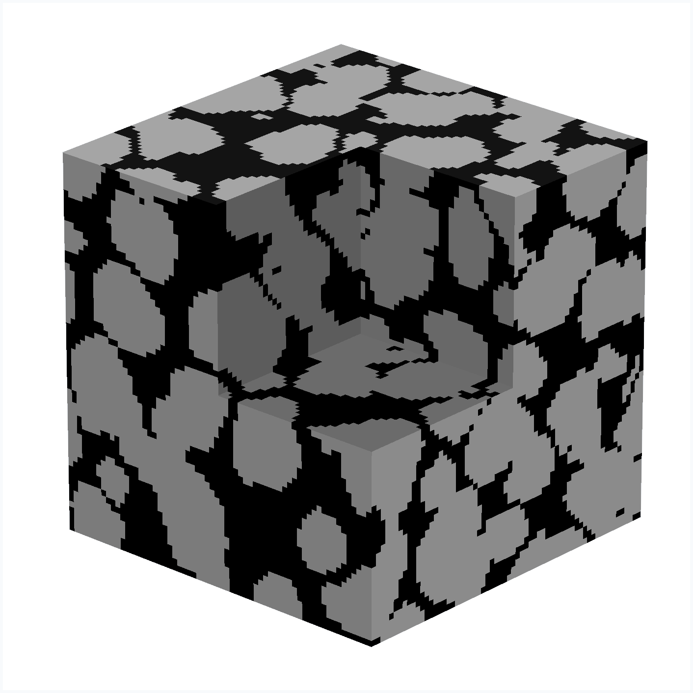

# Diffusion-GAN 3D

Generate 3D microstructures from **2D label images**, without measured 3D training targets.
Learn the appearance of real sections, guide generation with known planes,
and build larger or higher-resolution volumes.

[Quick start](#quick-start) · [Run and inspect](docs/checks.md) · [Development](docs/development.md) · [Method & experiments](PAPER.md)

| 2D training image and example crops | Generated 3D volume |
| :---: | :---: |
|  |  |

Examples from the [recorded experiments](PAPER.md); their settings differ from current defaults.

- **2D → 3D:** train from categorical sections in the `xy`, `xz`, and `yz` planes.
- **Plane conditions:** guide generation with known sections, called anchors.
- **Larger outputs:** combine overlapping tiles; refine with a separate super-resolution model.

## Quick start

Use Python 3.11+ with a PyTorch build for your GPU (CUDA or Apple MPS) or CPU.

```bash
git clone https://github.com/phykn/diffusion-gan3d.git
cd diffusion-gan3d
python -m venv .venv
source .venv/bin/activate   # PowerShell: .\.venv\Scripts\Activate.ps1
python -m pip install -r requirements.txt
```

Input images are set in [config/data/default.yaml](config/data/default.yaml) (default:
`data/sample.png`). Each must be a 2D uint8 image of phase IDs `0` to `num_phases - 1`.
`crop_size` is in source pixels; `lo_res_size` and `hi_res_size` are voxel grid sizes.

```bash
python scripts/01_check_dataset.py --no-view
python run_train_1st.py --run-dir "run/my-lr-run"
python scripts/02_check_generated.py --weight "run/my-lr-run" --no-view
```

[config/train/low_res.yaml](config/train/low_res.yaml) controls training. Use a new
`--run-dir` per run; it stores weights and resolved settings, while inspection results
go to `checks/`. The device is CUDA, then MPS, then CPU unless `--device` is given;
mixed precision runs only on CUDA.

## Super-resolution (optional)

Stage 2 trains a separate model from frozen stage-1 volumes and real high-resolution
sections ([config/train/sr.yaml](config/train/sr.yaml)):

```bash
python run_train_2nd.py --base-weights "run/my-lr-run" --run-dir "run/my-sr-run"
python scripts/06_check_hr.py --weight "run/my-sr-run" --no-view
```

## Web interface

Start the backend with an LR run, then the frontend in another terminal (Node.js required):

```bash
python backend/run.py --weight "run/my-lr-run"
```

```bash
cd frontend
npm ci
npm run dev
```

Open the URL Vite prints. For a non-default backend address, use
`API_URL=http://HOST:PORT npm run dev`; after `npm run build`, the backend serves the page
itself (default http://127.0.0.1:8000). The API is `GET /api/health`, `POST /api/prepare`,
and `POST /api/generate`; HTTP limits are in [backend/config.yaml](backend/config.yaml).

## Python API

[src/api.py](src/api.py) provides `LowResolutionAPI`, `PlaneAnchor`, and `SuperResolutionAPI`.
`generate` returns labels and `generate_probs` phase fractions, for example
`api.generate_probs(shape=(96, 64, 64), seed=1)`.

Generated volumes are plausible samples, not measurements of an unknown 3D specimen.

[MIT License](LICENSE)
