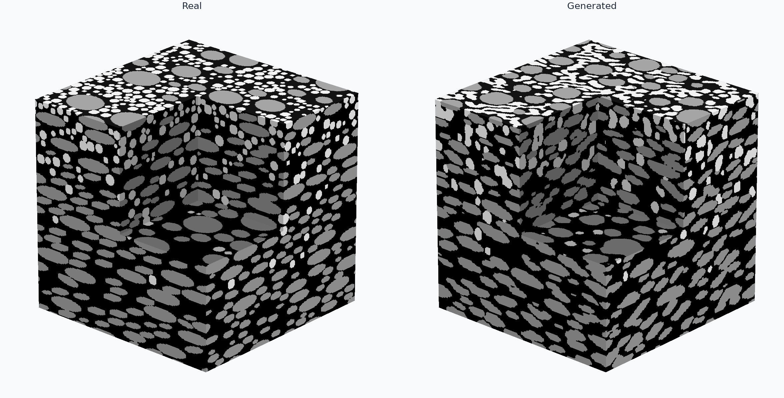
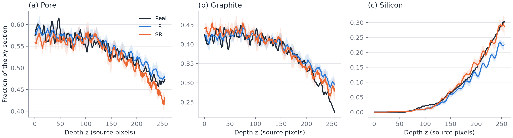
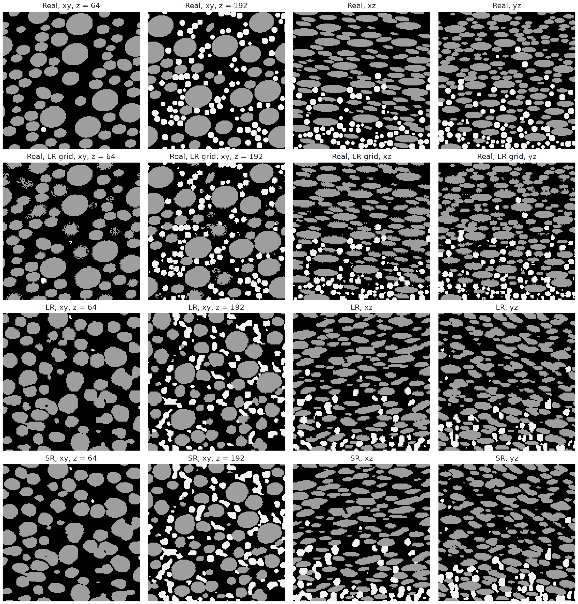

  <h1>Generating 3D Microstructures from 2D Sections with a Two-Stage Diffusion-GAN</h1>

## Abstract

We present a two-stage diffusion-GAN that learns 3D categorical microstructures from unregistered 2D sections: a low-resolution (LR) stage generates the 3D arrangement, and a super-resolution (SR) stage refines it to the source resolution. Both denoisers are trained only through 2D critics, with losses that penalize differences between the axes of each volume and, for LR, between mirrored diagonal statistics. Each stage's exported step is chosen by a section-structure score normalized by the real data's own sampling noise. On an isotropic binary image, LR volumes match the real interface density, percolate in both phases and have nearly isotropic pore tortuosity, but undershoot the pore fraction and keep a preferred particle tilt. SR sections lie 1.6–2.2 times closer to real sections than upsampled LR volumes while keeping the LR arrangement. Supplied planes are applied at inference by diffusion posterior sampling without anchor-specific training: a plane is reproduced with about 95% voxel agreement and no seam, and sixteen planes recover 90.2% of a known volume. On a simulated graphite–silicon anode with in-plane flakes and depth-graded silicon, depth-conditioned volumes follow the real depth profile and, against the real 3D volumes, reproduce the strongly anisotropic pore tortuosity within 5.1% and the flake thickness within 1%, but not the shape of silicon particles or the direction of flake tilt.

## Introduction

Three-dimensional connectivity controls many transport and mechanical properties, but 3D scans are harder to obtain than 2D micrographs. Feature-matching and conditional neural methods reconstruct 3D microstructures from a 2D exemplar [1,2], and SliceGAN [3] learns a volumetric generator from 2D images alone by judging its sections with 2D critics. Diffusion models have since been used for 2D-to-3D expansion [4,5,6], property-conditioned methods control phase fraction or spatial statistics [7,8], and volumetrically supervised methods reconstruct from sparse or surface slices [9,10,11].

Two problems remain when only 2D sections exist. Section realism is a weak constraint on the volume: a generator can keep every section plausible while choosing an unrealistic 3D arrangement, for example by shearing structure so that only one section plane degrades. And without 3D data there is no direct way to decide which training step to export. Applications also need known planes, such as a measured surface, to be honored without training a conditional model; diffusion inpainting preserves observed regions [12,13], and diffusion posterior sampling (DPS) [17] steers an unconditional model with the gradient of a measurement error on its clean prediction.

Here a low-resolution (LR) stage generates the 3D arrangement and a super-resolution (SR) stage, trained the same way on frozen LR volumes, refines it to the source resolution. Each is a 3D denoising-diffusion GAN [14,15] trained only through 2D critics on pairs of adjacent diffusion states, with the relativistic loss and burn-in of R3GAN [16], and losses on the whole volume penalize differences between its three axes and between its mirrored diagonals, to discourage shear. The exported step is chosen by a section-structure score computed from 2D data, and known planes are applied at inference by DPS. We test it on an isotropic binary image and on a simulated anode whose flakes lie in one plane and whose composition changes with depth, where real 3D volumes allow direct comparison. The goal is plausible realizations from unregistered 2D sections, not a unique reconstruction.

## Results

### Two-stage generation from 2D sections

The training data are one 226 × 690 binary image (Figure 1). Random 128² crops supervise all three axes under an isotropy assumption. Each crop is area-downsampled by two for the LR stage, so one LR voxel spans two source pixels. The LR model thus sees a large field of view and learns the arrangement of particles, while the SR model, refining frozen LR volumes back to the source resolution, mostly adds boundary detail consistent with it. The LR stage trained for 10,000 steps (88 minutes on one Apple-silicon GPU) and the SR stage for 5000 steps (2.9 hours).

  

<em>Figure 1. Binary training image. Orange boxes are example 128² crops; the middle one is the external anchor. Black: phase 0; gray: phase 1.</em>

### Training and checkpoint selection

The selection score falls quickly early in burn-in, stays near 2.9 from step 3000 to the end of burn-in, and then falls again to its lowest value at the last step, 10,000 (Figure 2a). Its components move in different directions: cluster error falls by a factor of almost four, while two-point error rises after step 2500 (Figure 2b). The critic separates real from generated pairs increasingly well: the gap between their mean logits widens from about 1.7 at the end of burn-in to 2.2–2.3 from step 8000 on (Figure 2c). The score keeps falling while this gap widens, so a growing critic margin did not stop section improvement within this run.

<em>Figure 2. LR training. (a) Selection score; lower is better. (b) Its components, averaged over planes and divided by the half-split error of the evaluation crops (Table 1), so their scale differs from (a). (c) Mean critic logit of real and generated pairs, 200-step moving average. Gray: burn-in. Dashed: selected step 10,000.</em>

On a second random set of crops (Table 1), step 10,000 again scores lowest of the four saved steps (scores here exceed selection scores, which use fewer crops; Methods). The selected step is also the last, so selection did not change the exported weights, and since the score was still falling, a longer run might score lower; this is untested. The two-point error of step 10,000 is mostly a phase-fraction offset: with the real correlation shape, its pore fraction alone would give a two-point error of 0.0091, of the 0.0095 observed. The pore fraction falls in the same steps in which cluster error improves, suggesting the generator traded a little pore volume for better-separated particles.

| Step | Structure ↓ | Two-point | Chord | Cluster | Pore fraction | Interface density |
|---|---:|---:|---:|---:|---:|---:|
| Real crops | — | — | — | — | 0.367 ± 0.050 | 0.1227 ± 0.0071 |
| 2500 | 5.77 | 0.0075 | 0.0985 | 0.402 | 0.374 ± 0.005 | 0.1119 ± 0.0013 |
| 5000 | 4.98 | 0.0060 | 0.0826 | 0.353 | 0.363 ± 0.006 | 0.1162 ± 0.0015 |
| 7500 | 4.51 | 0.0065 | 0.0779 | 0.307 | 0.362 ± 0.006 | 0.1208 ± 0.0015 |
| **10000 (selected, last)** | **3.95** | 0.0095 | 0.0769 | 0.229 | 0.358 ± 0.007 | 0.1224 ± 0.0015 |

<em>Table 1. Section errors of 16 volumes per step against a second random set of 128 real crops, averaged over the three planes. ± is one standard deviation, over crops for real values and over volumes for generated ones.</em>

### Microstructure of generated volumes

The sections of the selected step reproduce rounded solid particles separated by a connected pore network (Figures 3 and 4), and the interface density matches the real crops within 0.3%. Both phases percolate along every axis (99.9% of pore and 97.9% of solid voxels lie in spanning components). No measured 3D volume exists, so the 3D measures are judged against the isotropic, mirror-symmetric structure assumed in training. The pore tortuosity meets the isotropy: 2.15 ± 0.09, 2.20 ± 0.11, and 2.12 ± 0.10 along z, y, and x, all within one standard deviation of each other. The mirror symmetry is not met: solid particles keep a preferred tilt in the xy plane (balance 0.19 over 177 particles, where a mirror-symmetric structure gives 0; the mean slope lies 3.7 standard errors from 0). The data do not explain this tilt: the training image shows −0.13 over 54 particles on the LR grid, of the opposite sign and 1.2 standard errors from 0, and random flips of the training sections make the target nearly symmetric. Generated sections receive the same flips, however, so the critic cannot see the direction of a tilt, and the mirror-balance loss, the one term that compares the two directions, tolerates differences up to ε (Methods).

<em>Figure 3. Unconditional 64³ LR sample at step 10,000 with one octant removed.</em>

<em>Figure 4. Top: real crops on the LR grid. Bottom: center sections of the volume in Figure 3.</em>

### Plane anchors

DPS raises agreement on the anchored plane from 52–54%, the chance agreement of unrelated sections at this pore fraction, to 95.4% for internal planes and 95.0% for the real external section (Table 2, Figure 5a–c). The external section is a real image rather than a model sample, yet it is matched as well, also at the first section of the output (94.8%), which has generated structure on both sides because generation samples an 8-voxel margin around the output. Pool4 similarity is less than one point above exact agreement, so the remaining errors are not small boundary shifts but particles or necks placed differently.

| Anchor | Cases | Exact, no guidance | Exact, DPS ↑ | Pool4, DPS ↑ | First change, DPS | First change, baseline | Flicker / baseline |
|---|---:|---:|---:|---:|---:|---:|---:|
| Internal | 24 | 53.8 ± 2.6% | 95.4 ± 0.9% | 95.9 ± 0.8% | 0.66 ± 0.06 | 0.99 ± 0.08 | 1.28 ± 0.32 |
| External, center | 8 | 51.5 ± 2.5% | 95.0 ± 0.5% | 95.6 ± 0.6% | 0.68 ± 0.05 | 0.95 ± 0.07 | 1.39 ± 0.36 |
| External, boundary | 8 | 53.9 ± 3.4% | 94.8 ± 0.3% | 95.5 ± 0.4% | 0.65 ± 0.08 | 0.96 ± 0.11 | 1.11 ± 0.18 |

<em>Table 2. Single-plane anchors at the selected step.</em>

The anchor creates no seam: next to every kind of anchor, sections change less than ordinary adjacent sections (first change 0.65–0.68 against 0.95–0.99 for the baseline), consistent with DPS pulling the neighbors toward a structure compatible with the anchor. Flicker rises by a tenth to two-fifths, so the change rate varies somewhat more along the volume.

The anchor's 3D information reaches a few voxels (Figure 5d). Agreement with the internal reference falls from 95.4% on the plane to 84.5% one voxel away, 62.8% at four, and 57.9% at twelve, approaching the 54–55% of unrelated volumes. The far field, however, is not the baseline volume, because the gradient moves the whole noisy state (Methods).

<em>Figure 5. Plane anchors. (a) Real external section; (b) generated plane at the anchored coordinate; (c) the same coordinate without guidance; right: sections at distance d from the anchor. (d) Agreement with a known reference against distance from one anchored plane; shading: ±1 SD over the 24 cases. (e) Agreement with a known reference as nested planes are anchored.</em>

More planes recover more of a known volume (Figure 5e): agreement rises from 54.3% with no anchors to 77.5% with eight planes and 90.2% with sixteen, and unanchored planes follow closely, so the gain is not only the anchored planes themselves. Beyond sixteen planes the curve levels off at 93–94%, slightly below single-plane accuracy; with all 64 planes anchored, the anchored planes themselves agree to 93.1%.

### Super-resolution

The SR selection score fell at every evaluation from step 1500 on and was lowest at the last step, 5000 (Figure 6a), which also beats step 2500, the only other saved step, on the second crop set (Table 3). As in LR, a longer run might score lower. Real and generated critic logits fall together, 0.2–0.5 apart throughout (Figure 6c), so the widening gap seen in LR does not appear within these steps. As the score falls, the downsampled output moves away from its LR input (Figure 6b): SR improves its sections partly by changing the coarse structure it is given.

<em>Figure 6. SR training. (a) Selection score at source resolution; lower is better. (b) Mean squared difference between the area-downsampled output and the LR input on the selection inputs. (c) Mean critic logit of real and generated pairs, 200-step moving average. Gray: burn-in. Dashed: selected step 5000.</em>

At source resolution, SR sections score well below nearest-neighbour and trilinear upsampling of the same LR volumes (Table 3, Figure 7). Nearest upsampling keeps the two-voxel steps of the LR grid, which the chord distribution penalizes; trilinear upsampling smooths the steps but raises the cluster error. SR lowers the chord error to a sixth of nearest upsampling's, but not the cluster error: like both upsamplings, it shows about a third fewer separate pore regions per section than real crops, a deficit of its LR inputs, and it splits the solid into 17% more regions than real crops (nearest: 4%), visible as small specks in Figure 7. SR keeps the pore fraction of its LR inputs, so the two-point error, mostly this offset in LR, stays near that of nearest upsampling. The interface density exceeds the real crops' by 2.6%, whereas the upsamplings fall 4% and 7% short. SR sections are not indistinguishable from real ones: chord and cluster errors remain about three and nine times the real half-split error.

| Volumes | Structure ↓ | Two-point | Chord | Cluster | Pore fraction | Interface density | LR agreement |
|---|---:|---:|---:|---:|---:|---:|---:|
| Real crops | — | — | — | — | 0.368 ± 0.050 | 0.0635 ± 0.0043 | — |
| LR, nearest | 10.18 | 0.0100 | 0.4967 | 0.243 | 0.358 ± 0.007 | 0.0607 ± 0.0008 | 100% |
| LR, trilinear | 7.28 | 0.0116 | 0.1388 | 0.422 | 0.356 ± 0.007 | 0.0591 ± 0.0007 | 99.0% |
| SR, step 2500 | 7.00 | 0.0064 | 0.0973 | 0.480 | 0.363 ± 0.008 | 0.0616 ± 0.0008 | 98.5% |
| **SR, step 5000 (selected)** | **4.69** | 0.0092 | 0.0763 | 0.278 | 0.359 ± 0.009 | 0.0651 ± 0.0009 | 98.2% |

<em>Table 3. Section errors at source resolution of 16 HR volumes, all refined from the LR volumes of Table 1's selected step, against the crops of Table 1 at source resolution; averages and ± as in Table 1.</em>

<em>Figure 7. Top: real crops at source resolution. Below: center sections of one LR volume after nearest-neighbour and trilinear upsampling, and after SR.</em>

SR keeps the arrangement chosen by LR. Downsampled back to the LR grid, 98.2% of LR voxels keep their LR phase, and SR changes 5.6% of HR voxels relative to nearest upsampling. Two SR seeds on the same LR input differ in 3.1% of voxels, so part of what SR adds is set by its LR input and part varies between samples. Both phases still percolate along every axis (100.0% of pore and 98.6% of solid voxels lie in spanning components). Pore tortuosity is 1.90 ± 0.07, 1.96 ± 0.10, and 1.85 ± 0.08 along z, y, and x, 4–6% below nearest-upsampled LR volumes on the same grid (2.00, 2.04, 1.96) at an unchanged pore fraction, and as nearly isotropic (Figure 8).

<em>Figure 8. SR refinement of the volume in Figure 3 to 128³ voxels, one voxel per source pixel, with one octant removed.</em>

### An anisotropic, depth-graded structure

The second test case is a simulated graphite–silicon anode for which real 3D volumes exist (Figure 9). Graphite flakes are oblate and lie roughly in the xy plane, and silicon spheres fill part of the pore space with a fraction that rises from 0 at z = 0 to about 0.3 at the far face. Sections of two simulated 256³ volumes are the training data; the volumes themselves are never shown to the model and serve as ground truth. Separate critics judge xy and side sections, both stages are conditioned on depth, and LR also on the phase-fraction profile along depth (Methods). The LR stage trained for 10,000 steps (93 minutes), with step 8500 selected, and the SR stage for 5000 steps (3.0 hours), with the last step selected. Generated volumes are compared with the real volumes on the LR grid and at source resolution (Methods).

<em>Figure 9. A real anode volume and an SR volume at source resolution, depth z drawn upward, with one octant removed. Black: pore; gray: graphite; light: silicon.</em>

Both stages follow the real depth profile (Figure 10). LR receives this profile as its condition, so its agreement shows that the condition is honored, not that the profile is learned. It falls short at the deep end: in the deepest eighth of the depth, LR volumes hold 0.204 silicon against 0.255 for the real volumes on the LR grid, and more graphite (0.311 against 0.266). SR, which receives the depth but no profile, restores the silicon there (0.258 against 0.261) while keeping 97.1% of LR voxels in their LR phase; its overall silicon fraction is 0.079 against 0.078.

<em>Figure 10. Phase fraction of each xy section against depth. Real: mean of the two real volumes at source resolution; LR and SR: mean over generated volumes, shading ±1 SD.</em>

Sections are compared with the real sections at matching depths, and each error is divided by the error between the sections of the two real volumes, a coarse scale because these volumes differ in graphite fraction (0.395 and 0.365). On this scale LR scores 1.06 in xy and 0.81 on the side planes: its two-point and chord errors lie below the difference between the two real volumes, its cluster error 1.4–2.2 times this difference. SR scores 1.67 at source resolution, against 2.03 and 1.86 for nearest and trilinear upsampling, a smaller gain over upsampling than for the isotropic sample. The sections show what these averages hide (Figure 11): generated silicon forms irregular, partly elongated and merged bodies instead of separate spheres, and generated flakes are visibly tilted in yz sections.

<em>Figure 11. Anode sections: xy at two depths (in source pixels) and the center xz and yz sections, of one real volume at source resolution and on the LR grid, and of one LR volume and its SR refinement. Area downsampling leaves exact ties at flake faces, broken at random, which speckles real xy sections on the LR grid.</em>

The real volumes allow direct 3D comparison (Table 4). Flakes lying in xy make pore transport much harder along z than along y or x, and the generated volumes reproduce this anisotropy: their pore tortuosity differs from the real values by at most 2.0% on the LR grid and 5.1% at source resolution, where the two real volumes themselves differ by about 10% along z. The flake thickness, the mean graphite chord along z, is within 1% of real on both grids, and lateral graphite chords within 12%. Silicon is coarser than real: its mean chords are 5–20% longer at source resolution. As in the real volumes, pore percolates along every axis, and graphite spans laterally but not through the depth at source resolution. Silicon spans no axis of either real volume at source resolution, but spans laterally in some SR volumes, consistent with its merged bodies.

| Measure | LR | Real, LR grid | SR | Real |
|---|---:|---:|---:|---:|
| Pore tortuosity, z | 2.24 ± 0.01 | 2.23 | 2.05 ± 0.01 | 2.01 |
| Pore tortuosity, y | 1.43 ± 0.00 | 1.46 | 1.38 ± 0.01 | 1.31 |
| Pore tortuosity, x | 1.35 ± 0.01 | 1.36 | 1.26 ± 0.01 | 1.24 |
| Graphite chord, z | 4.39 ± 0.03 | 4.37 | 8.53 ± 0.06 | 8.46 |
| Graphite chord, y | 8.77 ± 0.08 | 7.86 | 16.49 ± 0.13 | 17.38 |
| Graphite chord, x | 10.08 ± 0.09 | 9.34 | 21.23 ± 0.09 | 21.29 |
| Silicon chord, z | 4.41 ± 0.04 | 3.84 | 9.64 ± 0.14 | 8.06 |
| Silicon chord, y | 4.05 ± 0.05 | 3.96 | 8.71 ± 0.11 | 8.31 |
| Silicon chord, x | 4.48 ± 0.04 | 3.96 | 9.58 ± 0.10 | 8.30 |
| Graphite tilt balance, dz/dy | 0.47 | 0.27 | 0.56 | 0.27 |
| Graphite tilt balance, dz/dx | −0.27 | 0.09 | −0.29 | 0.14 |
| Graphite tilt balance, dy/dx | −0.17 | −0.51 | −0.26 | −0.54 |

<em>Table 4. 3D measures of 8 LR and 4 SR volumes against the two real volumes on the same grid; chords are mean run lengths in voxels of that grid. ± is one standard deviation over generated volumes; real values are means of the two volumes; tilt balances pool all particles.</em>

The flake tilt is not reproduced. The simulation draws flakes from a fixed library of rotated shapes, so the real volumes carry a net tilt. LR exaggerates the tilt of flakes toward y, reverses it toward x, and weakens the in-plane orientation (Table 4); SR keeps these errors. One critic judges xz and yz sections alike, so it may constrain only the tilt pooled over the two side planes; this is a hypothesis we did not test.

## Discussion

A 3D generator trained only through 2D critics can produce volumes whose sections lie within a few times the data's own sampling noise of real sections. Section statistics, however, do not pin down the third dimension. On the isotropic image, where no 3D data exist, the volumes meet the assumed isotropy in tortuosity but not the assumed mirror symmetry in particle tilt. On the anode, the real volumes show that the model reproduces the in-plane flakes and with them the anisotropic pore tortuosity, but misses the shape of the sparse silicon particles and the direction in which flakes tilt.

Selection by section structure needs only 2D data, but on the isotropic image, where neither stage's score had stopped falling, it confirmed the last step rather than choosing an earlier one; on the anode it chose LR step 8500, whose selection score is 2% below the last step's. Its statistics can disagree, as the opposite trends of cluster and two-point error show, and their equal weighting is a choice, not a derivation, whose scale depends on the number of real crops.

The two stages divide the errors. SR repairs what the LR grid cannot represent, the two-voxel steps that dominate the chord error, but it inherits the 3D arrangement and, on the isotropic image, the pore fraction and the missing pore regions, so these have to be fixed in LR. It is not limited to boundaries, however: on the anode it restores the deep silicon that LR undershoots. SR drifts from its input as its sections improve, so the consistency loss bounds rather than prevents changes to the coarse structure.

Posterior sampling avoids training a separate anchor model, at the price that the whole volume changes: DPS gives up a fixed baseline far from the anchor in exchange for continuity near it; pasting the plane into a fixed sample was not compared. That controlled recovery levels off slightly below single-plane accuracy suggests that DPS accuracy, not missing information, limits agreement; stronger guidance, or guidance during SR, may raise it.

Conditioning on depth lets one model generate a graded structure, and the profile condition sets its composition.

The study has clear limits. The isotropic image has no measured 3D volume, so 3D reconstruction accuracy and true tortuosity cannot be measured there; its internal anchors come from the model itself, the external anchor is a crop of the training image, and its volumes are small relative to the particle size, so tortuosity, which depends on the grid, and percolation compare generated volumes on one grid rather than estimate material properties. The anode is simulated, and its real volumes also supply its training sections, so the 3D comparison tests 2D-to-3D generation, not generalization to an unseen specimen; with two real volumes, the real values and the section scale rest on two samples. All results come from one training run per stage and sample with no ablations, so they describe the integrated system, not the contribution of each part, and the causes of the particle tilt, of the reversed flake tilt, and of the LR silicon deficit at depth are untested. Only four LR and two SR steps of the isotropic runs kept their weights, so the second crop set checks selection among those alone, and not independently: both crop sets come from the one image, and 8 of the 16 evaluated LR volumes use the selection's seeds. Isotropic LR volumes are generated without a target phase fraction, a condition met in only 10% of training steps and one on which the phase-fraction loss never acts (Methods); whether supplying the real fraction removes the pore undershoot is untested. Isotropic volumes are evaluated as single 64³ blocks refined by SR in one tile; tiled generation and refinement are evaluated only on the anode, and DPS across tiles and on the anode not at all.

## Methods

### Data

In the isotropic image, phase 0 is pore and phase 1 is solid. The image's provenance and physical pixel size are unknown, so results are in voxels. Sections normal to each axis need not be registered; here one image serves all three.

The anode volumes come from a packing simulation in the repository. Graphite flakes are oblate ellipsoids drawn from a fixed library of rotated shapes whose normals scatter around z; silicon spheres then fill free space while each depth slice is below its target fraction. Phase 0 is pore, 1 graphite and 2 silicon. Sections normal to each axis of both volumes are the training images, so xz and yz sections span the full depth.

### Denoiser and pair critics

The forward process is a variance-preserving diffusion on one-hot phases scaled to ±1, with ten transitions. A 3D U-Net receives the noisy state, the transition index, a fresh latent vector, and a target phase fraction taken from a real crop, and predicts phase logits; with their softmax $p$, the clean prediction $\hat x_0=2p-1$ defines one Gaussian posterior step, as in denoising diffusion GANs [15]. Training drops the target fraction in 10% of steps for classifier-free guidance. The isotropic volumes reported here are generated without a target, so guidance does not change them; anode LR volumes are generated with their depth profile as target (Depth conditioning) and the repository's default guidance.

Each training step generates one volume up to a random transition $t$ and cuts sections normal to every axis from the pair $(x_t,x_{t+1})$. A 2D critic scores the two sections together, $D(x_t,x_{t+1},t)$, at each scale of an area pyramid down to 16² pixels, three scales for LR; real pairs come from noising real crops. For an isotropic material one critic serves all planes, and every real and generated pair receives a random flip or 90° rotation other than the identity. The critic is trained with the relativistic pairing loss of R3GAN [16],

$$
\mathcal{L}_D=\mathbb{E}\big[\log(1+e^{D(\tilde x)-D(x)})\big],
$$

with each generated pair $\tilde x$ matched to a real pair $x$, plus zero-centered gradient penalties on real (R1) and generated (R2) pairs, taken with respect to the less noisy section $x_t$ only and applied every eighth critic update. R3GAN motivates this regularized relativistic loss as a remedy for mode dropping and non-convergence [16]. Over the first half of training, a cosine burn-in lowers the learning rates to a quarter and the penalty weights to a fraction of their values, raises Adam's $\beta_2$ from 0.9 to 0.99, and lengthens the EMA [16].

### Statistical losses on the clean volume

Critics judge sections one at a time. Four further terms act on the predicted phase probabilities of the volume. Real transitions and axis agreement act only at the last transition ($t=0$), each with weight 0.1 ramped in over the burn-in.

- **Phase fraction** matches the volume's mean phase fractions to the target fraction, when one is given, by KL divergence.
- **Real transitions** match the joint distribution of phases at in-plane gaps of up to 8 voxels, on 16 sections per plane, to that of real crops, a direct signal on correlation length.
- **Axis agreement** penalizes differences between the phase-pair statistics along the axes normal to the planes one critic judges, three for an isotropic material, at gaps of 1–8 voxels, beyond a tolerance of 0.01. Unlike the critic, it compares directions inside one volume, so anisotropy is penalized even when every plane looks realistic.
- **Mirror balance**, used for the isotropic image, targets shear. A structure such as $f(y,x-z)$ keeps xy and yz sections realistic and turns only xz sections into stripes, which axis-aligned statistics cannot see. For each coordinate plane and diagonal offset $(a,b)$, the loss compares the phase-pair table $P$ at $(+a,+b)$ with its mirror at $(+a,-b)$:

$$
\mathcal{L}_{\mathrm{mirror}}=\mathbb{E}_{\text{plane},(a,b)}\Big[\max\big(0,\;\tfrac12\lVert P_{+a,+b}-P_{+a,-b}\rVert_1-\epsilon\big)\Big],
$$

with $\epsilon=0.02$ and weight 10, at every transition.

### Depth conditioning

For the anode, one critic judges xy sections and a second judges xz and yz sections, axis agreement compares only y and x, and augmentations that would reverse z or exchange it with y or x are disabled. Both denoisers receive each voxel's depth, normalized over the source depth. The LR denoiser also receives a target phase-fraction profile along depth, with its mean as the target fraction: in training, the profile of the real side section that sets the volume's depth range, which a loss matches to the volume's mean fractions per depth; in generation, the profile of all training sections. Larger volumes are generated in overlapping tiles, each with the depth and profile of its own position.

### Super-resolution

The SR denoiser has the same form, with the LR phase fractions, resized to the output grid, as an extra input. It refines volumes from the frozen LR generator, held in a bank of eight volumes of which one is replaced every 500 steps, and is judged by its own pair critic of the same design on real crops at source resolution (four pyramid scales), together with axis agreement. SR's axis agreement adds the LR input's own axis differences to the tolerance, so it does not ask SR to remove anisotropy that LR generated. Random coarse blocks of the input are sometimes replaced by random phases, and the network receives the corrupted fraction, so it is not forced to copy errors in its input. In place of the other statistical losses, a consistency loss with weight 10 penalizes the squared difference between the area-downsampled clean prediction and the LR input on uncorrupted voxels beyond a tolerance of 0.005.

### Checkpoint selection

Every 500 steps the EMA generator produces 8 volumes from fixed seeds, and 128 of their sections per plane are compared with 64 fixed real crops per plane by three statistics: two-point correlation, chord-length distribution, and cluster density and size per phase. Cluster statistics are included because merged pores and fragmented solid can match both two-point and chord statistics while changing 3D connectivity. Each error is divided by the same error between two halves of the real crops, so 1 means "as far from the data as the data is from itself" at this number of crops; the normalized errors are averaged over statistics and planes into one score, and the lowest-scoring step is exported. The half-split error shrinks as crops are added, so the 128-crop evaluation below gives larger scores than selection (3.95 against 2.38 for step 10000). SR is scored on refinements of fixed bank volumes at source resolution. With depth conditioning, scored volumes take the depth ranges of fixed real side crops.

### Plane anchors

The denoiser is trained without any anchor condition. At inference, an anchor with values $y$ on mask $M$ steers every reverse step but the last by DPS [17]:

$$
x_t\leftarrow x_t-\frac{s}{\mathrm{RMS}}\,\nabla_{x_{t+1}}\big\lVert M\odot(\hat x_0(x_{t+1})-y)\big\rVert^2,
$$

where RMS is the root-mean-square anchor error, so the step does not depend on how much anchor area a volume holds. The gradient flows through the whole denoiser and moves the entire noisy state, so neighboring sections are pulled toward a structure compatible with the anchor instead of meeting it at a seam. Nothing is clamped or pasted; the anchored plane itself is generated.

### Evaluation

**Structure.** Each evaluated checkpoint generates 16 unconditional 64³ volumes from seeds 0–15, which include the selection's seeds 0–7, and compares them with a second random set of 128 crops of the training image, drawn with another seed than the selection's; the same crops serve all three planes. The structure score is computed as in selection, with the half-split error of these 128 crops. Real values are averages over random crops, the distribution the model is trained on. *Interface density* is the fraction of neighboring voxel pairs with different phases, averaged over the axes of a section or volume. For the selected step we also report percolation (fraction of a phase in components spanning an axis), pore tortuosity along each axis [18], and the tilt balance of solid particles (fraction tilted one way minus the other).

**Super-resolution.** The 16 LR volumes of the selected LR step are refined once each, in one tile, and compared with the same 128 crops at source resolution; the baselines upsample the same LR phase fractions. *LR agreement* is the fraction of LR voxels whose majority phase after area downsampling of the HR volume is the LR phase. Tortuosity and percolation are computed as for LR.

**Anode.** Eight LR volumes of 128³ voxels, seeds 0–7, assembled from overlapping 64³ tiles to cover the full width and depth of the real volumes, are generated, and the first four are refined by SR to 256³ in tiles. LR volumes are compared with the real volumes area-downsampled to the LR grid, with exact ties broken at random, and SR volumes with the real volumes at source resolution. Section statistics compare 128 evenly spaced sections per plane of each set, so every depth is represented, and are scaled by the same errors between the sections of the two real volumes. Tortuosity, percolation, mean chord length (the mean run length of a phase along an axis) and tilt balance are computed on whole volumes.

**Anchors.** Each anchored sample is compared with a same-noise baseline, the same seed without guidance. Guidance moves the whole noisy state, so anchored and baseline volumes differ in 40–46% of voxels at every distance from the anchor, about as much as unrelated volumes (about 45%); the baseline is a reference sample of the model, not a paired counterfactual. *Internal anchors* take the center plane of an unconditional reference volume along each axis (24 cases); since the reference is known in 3D, agreement can be measured at every distance from the plane. *External anchors* use the real crop of Figure 1 at the center or the first section of the 64³ output (8 cases each). *Controlled recovery* anchors a growing, nested set of planes from a reference volume (4 cases). *Pool4* is the agreement of 4 × 4-cell phase fractions, which tolerates small boundary shifts. *First change* is the label-change rate next to the anchor divided by the ordinary rate between adjacent sections; above 1 indicates a seam. *Flicker* is the 95th percentile of the change in adjacent-section change rate, relative to the baseline.

## Code availability

Code, settings, the training image, the anode simulation, and the evaluation scripts are available at https://github.com/phykn/diffusion-gan3d. The reported runs used the `default` and `simul_anode` samples at commit f113ab8. `paper/scripts/evaluate_lr.py --run <LR run>`, `evaluate_sr.py --run <SR run>` and `evaluate_anode.py --run <anode SR run>` write the reported numbers to `paper/assets/lr-results.json`, `sr-results.json` and `anode-results.json`, and `make_figures.py` draws the figures from them.

## References

[1] R. Bostanabad, “Reconstruction of 3D microstructures from 2D images via transfer learning,” *Computer-Aided Design*, vol. 128, art. 102906, 2020.

[2] J. Feng, Q. Teng, B. Li, X. He, H. Chen, and Y. Li, “An end-to-end three-dimensional reconstruction framework of porous media from a single two-dimensional image based on deep learning,” *Computer Methods in Applied Mechanics and Engineering*, vol. 368, art. 113043, 2020.

[3] S. Kench and S. J. Cooper, “Generating three-dimensional structures from a two-dimensional slice with generative adversarial network-based dimensionality expansion,” *Nature Machine Intelligence*, vol. 3, pp. 299–305, 2021.

[4] J. Phan et al., “Generating 3D images of material microstructures from a single 2D image: a denoising diffusion approach,” *Scientific Reports*, vol. 14, art. 6498, 2024.

[5] K.-H. Lee and G. J. Yun, “Multi-plane denoising diffusion-based dimensionality expansion for 2D-to-3D reconstruction of microstructures with harmonized sampling,” *npj Computational Materials*, vol. 10, art. 99, 2024.

[6] C. Düreth, P. Seibert, D. Rücker, S. Handford, M. Kästner, and M. Gude, “Conditional diffusion-based microstructure reconstruction,” *Materials Today Communications*, vol. 35, art. 105608, 2023.

[7] A. Sadeghkhani, B. Bennett, and A. Rabbani, “Property-constrained 3D porous media reconstruction from 2D images via conditional generative adversarial networks,” in *87th EAGE Annual Conference & Exhibition*, vol. 2026, pp. 1–5, 2026.

[8] Z. Ma et al., “A sliced-Wasserstein and neural network framework for statistically controllable 3D microstructure reconstruction,” *Computer-Aided Design*, vol. 198, art. 104100, 2026.

[9] S. Fan, Y. Li, X. Wang, and D. Du, “Dual-domain latent diffusion framework with multi-modal conditioning for controllable porous media reconstruction,” *Computational Materials Science*, vol. 272, art. 114876, 2026.

[10] Y. Shi et al., “GeoTopoDiff: Learning geometry–topology graph priors through boundary-constrained mixed diffusion for sparse-slice 3D porous reconstruction,” *arXiv preprint* arXiv:2605.03764, 2026.

[11] Y. Meng, J. Jiang, B. Zhao, S. Ye, D. Wang, and J. Wu, “Inferring internal structures of porous media from orthogonal external surfaces: A novel 2D-to-3D reconstruction method based on a deep conditional diffusion model,” *Journal of Geophysical Research: Machine Learning and Computation*, vol. 3, art. e2025JH001101, 2026.

[12] G. Zhang et al., “Towards coherent image inpainting using denoising diffusion implicit models,” in *Proceedings of the 40th International Conference on Machine Learning*, pp. 41164–41193, 2023.

[13] A. Lugmayr et al., “RePaint: Inpainting using denoising diffusion probabilistic models,” in *Proceedings of the IEEE/CVF Conference on Computer Vision and Pattern Recognition*, pp. 11461–11471, 2022.

[14] J. Ho, A. Jain, and P. Abbeel, “Denoising diffusion probabilistic models,” in *Advances in Neural Information Processing Systems*, vol. 33, pp. 6840–6851, 2020.

[15] Z. Xiao, K. Kreis, and A. Vahdat, “Tackling the generative learning trilemma with denoising diffusion GANs,” in *International Conference on Learning Representations*, 2022.

[16] Y. Huang, A. Gokaslan, V. Kuleshov, and J. Tompkin, “The GAN is dead; long live the GAN! A modern GAN baseline,” in *Advances in Neural Information Processing Systems*, vol. 37, 2024.

[17] H. Chung, J. Kim, M. T. McCann, M. L. Klasky, and J. C. Ye, “Diffusion posterior sampling for general noisy inverse problems,” in *International Conference on Learning Representations*, 2023.

[18] S. J. Cooper, A. Bertei, P. R. Shearing, J. A. Kilner, and N. P. Brandon, “TauFactor: An open-source application for calculating tortuosity factors from tomographic data,” *SoftwareX*, vol. 5, pp. 203–210, 2016.
