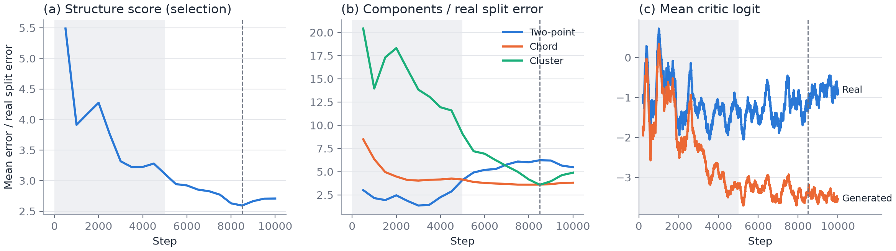
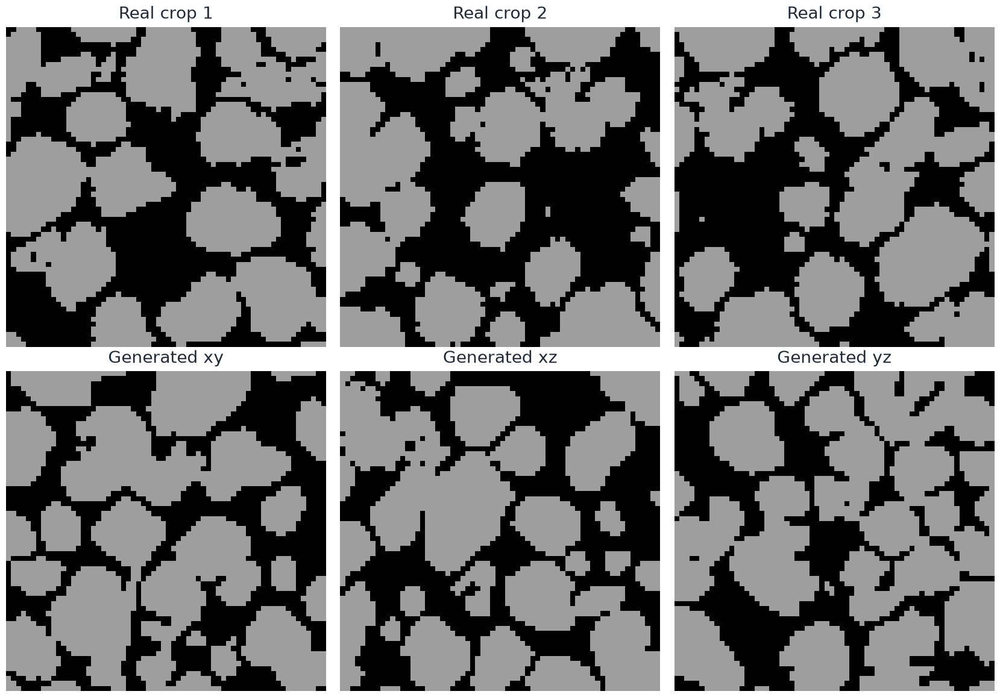
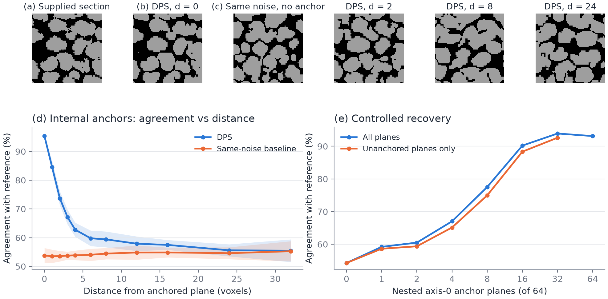
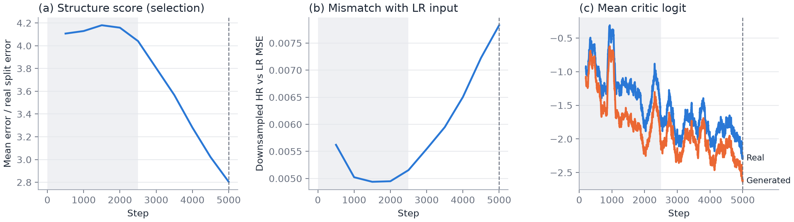
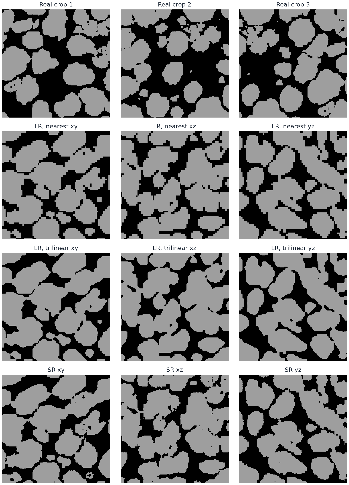

  <h1>Generating 3D Microstructures from 2D Sections with a Two-Stage Diffusion-GAN</h1>

## Abstract

We present a two-stage diffusion-GAN that learns 3D categorical microstructures from unregistered 2D sections: a low-resolution (LR) stage generates the 3D arrangement, and a super-resolution (SR) stage refines it to the source resolution. Both denoisers are trained only through 2D critics, together with losses that make the three axes of each volume agree and, for LR, mirrored diagonal statistics balance. Because no 3D data exist, the exported step of each stage is chosen by a section-structure score normalized by the real data's own sampling noise; for LR the chosen step also scores lowest of the saved steps on independent crops. LR volumes match the real interface density within 2.5% and percolate in both phases, but undershoot the pore fraction and show anisotropic tortuosity. SR sections lie three to four times closer to real sections than upsampled LR volumes, recover most of the missing pore fraction, and keep the LR phase in 96.5% of LR voxels; the tortuosity anisotropy remains. Supplied planes are applied at inference by diffusion posterior sampling without anchor-specific training: a plane is reproduced with about 90% voxel agreement and no seam, and sixteen planes recover 91.8% of a known volume. These are controlled generation results, not 3D reconstruction accuracy.

## Introduction

Three-dimensional connectivity controls many transport and mechanical properties, but 3D scans are harder to obtain than 2D micrographs. Feature-matching and conditional neural methods reconstruct 3D microstructures from a 2D exemplar [1,2], and SliceGAN [3] learns a volumetric generator from 2D images alone by judging its sections with 2D critics. Diffusion models have since been used for 2D-to-3D expansion [4,5,6], property-conditioned methods control phase fraction or spatial statistics [7,8], and volumetrically supervised methods reconstruct from sparse or surface slices [9,10,11].

Two problems remain when only 2D sections exist. Section realism is a weak constraint on the volume: a generator can keep every section plausible while choosing an unrealistic 3D arrangement, for example by shearing structure so that only one section plane degrades. And adversarial training on a single small image drifts: critics eventually memorize the data, so the last step is often not the best one, and no 3D data exist to choose another. Applications also need control: known planes, such as a measured surface, should be honored without training a conditional model; diffusion inpainting preserves observed regions [12,13], and diffusion posterior sampling (DPS) [17] steers an unconditional model with the gradient of a measurement error on its clean prediction.

Here we present a two-stage diffusion-GAN in which a low-resolution (LR) stage generates the 3D arrangement and a super-resolution (SR) stage refines it to the source resolution. A 3D denoising-diffusion GAN [14,15] is trained only through 2D critics on pairs of adjacent diffusion states, with the relativistic loss and burn-in of R3GAN [16]. Losses on the whole volume make its three axes agree and its mirrored diagonals balance, which suppresses shear. SR is trained in the same way on frozen LR volumes. The exported step of each stage is chosen by a section-structure score computed from 2D data, and known planes are applied at inference by DPS. The goal is plausible realizations from unregistered 2D sections, not a unique reconstruction.

## Results

### Two-stage generation from 2D sections

The training data are one 226 × 690 binary image (Figure 1). Random 128² crops supervise all three axes under an isotropy assumption. Each crop is area-downsampled by two for the LR stage, so one LR voxel spans two source pixels, and the SR stage refines frozen LR volumes back to the source resolution. The LR model thus sees a large field of view and learns the arrangement of particles, while the SR model only adds boundary detail consistent with it. The LR stage trained for 10,000 steps (90 minutes on one Apple-silicon GPU) and the SR stage for 5000 steps (3.2 hours). Generated volumes are compared with real crops by section statistics and by 3D measures (Methods).

  

<em>Figure 1. Binary training image. Orange boxes are example 128² crops; the middle one is the external anchor. Black: phase 0; gray: phase 1.</em>

### Training and checkpoint selection

The selection score falls during burn-in and reaches its minimum at step 8500, then rises (Figure 2a). Its components move in different directions: cluster error falls by a factor of five, while two-point error rises after step 3000 (Figure 2b). The critic logits suggest a cause for the late rise: from the end of burn-in, scores of real pairs keep climbing while generated pairs stay flat (Figure 2c), the signature of a critic memorizing the one training image. The score still falls for 3500 steps after this gap opens, mostly through cluster error, so memorization does not stop progress at once; it coincides with the turn rather than proving its cause.

<em>Figure 2. LR training. (a) Selection score; lower is better. (b) Its components, each divided by the real half-split error. (c) Mean critic logit of real and generated pairs. Gray: burn-in. Dashed: selected step 8500.</em>

On independent crops (Table 1), step 8500 again scores lowest of the five saved steps: 4.5% below the last step, which would otherwise be exported, and 23% below the end of burn-in. Its two-point error is mostly a phase-fraction offset: a pore fraction of 0.342 against 0.367 alone shifts the two-point curves by about 0.02 of the 0.028 observed. The pore fraction falls in the same steps in which cluster error improves, suggesting the generator traded a little pore volume for better-separated particles.

| Step | Structure ↓ | Two-point | Chord | Cluster | Pore fraction | Interface density |
|---|---:|---:|---:|---:|---:|---:|
| Real crops | — | — | — | — | 0.367 ± 0.050 | 0.1227 ± 0.0071 |
| 2500 | 7.64 | 0.0136 | 0.0864 | 0.577 | 0.382 ± 0.005 | 0.1202 ± 0.0016 |
| 5000 | 5.71 | 0.0168 | 0.0850 | 0.352 | 0.353 ± 0.005 | 0.1170 ± 0.0019 |
| 7500 | 4.61 | 0.0273 | 0.0761 | 0.175 | 0.342 ± 0.007 | 0.1191 ± 0.0016 |
| **8500 (selected)** | **4.41** | 0.0282 | 0.0765 | 0.146 | 0.342 ± 0.007 | 0.1197 ± 0.0014 |
| 10000 (last) | 4.62 | 0.0262 | 0.0822 | 0.173 | 0.344 ± 0.007 | 0.1192 ± 0.0016 |

<em>Table 1. Section errors of 16 volumes per step against independent real crops. Real values vary over crops; generated values over volumes.</em>

### Microstructure of generated volumes

The sections of the selected step reproduce rounded solid particles separated by a connected pore network (Figures 3 and 4), and the interface density matches the real crops within 2.5%. Both phases percolate along every axis (99.8% of pore and 98.5% of solid voxels lie in spanning components). No measured 3D volume exists, so the 3D measures are judged against the isotropic, mirror-symmetric structure assumed in training. The pore tortuosity departs from it, differing by axis: 2.23 ± 0.07, 2.62 ± 0.18, and 2.03 ± 0.09 along z, y, and x. One possible reason is scale: the axis and mirror losses act on statistics over a few voxels, whereas tortuosity integrates connectivity over the whole volume. Solid particles keep a slight preferred tilt in the xy plane (balance −0.17 over 177 particles, where a mirror-symmetric structure gives 0). The training image itself shows −0.13 over 54 particles on the LR grid, too few to tell from 0, and random flips of the training sections make the target symmetric, so the data do not explain this tilt.

<em>Figure 3. Unconditional 64³ LR sample at step 8500 with one octant removed.</em>

<em>Figure 4. Top: real crops on the LR grid. Bottom: center sections of the volume in Figure 3.</em>

### Plane anchors

DPS raises agreement on the anchored plane from about 55%, the chance agreement of unrelated sections at this pore fraction, to 93.2% for internal planes and 89.4% for the real external section (Table 2, Figure 5a–c). The external section is a real image rather than a model sample, yet it is matched only four points less well, and it is matched almost as well on the volume boundary (88.5%), where the structure continues on one side only. Pool4 similarity is only about one point above exact agreement, so the remaining errors are not small boundary shifts but particles or necks placed differently.

| Anchor | Cases | Exact, no guidance | Exact, DPS ↑ | Pool4, DPS ↑ | First change, DPS | First change, baseline | Flicker / baseline |
|---|---:|---:|---:|---:|---:|---:|---:|
| Internal | 24 | 55.6 ± 2.7% | 93.2 ± 1.8% | 94.1 ± 1.7% | 0.78 ± 0.12 | 1.03 ± 0.13 | 1.24 ± 0.28 |
| External, center | 8 | 54.1 ± 1.9% | 89.4 ± 3.8% | 90.4 ± 3.8% | 0.91 ± 0.12 | 0.96 ± 0.15 | 1.44 ± 0.30 |
| External, boundary | 8 | 54.4 ± 2.4% | 88.5 ± 3.0% | 89.9 ± 2.8% | 1.04 ± 0.11 | 1.03 ± 0.13 | 1.27 ± 0.18 |

<em>Table 2. Single-plane anchors at the selected step.</em>

The anchor creates no seam. Next to an interior anchor, sections change less than ordinary adjacent sections (first change 0.78 for internal and 0.91 for centered external anchors, against about 1 for the baseline), because DPS pulls the neighbors toward a structure compatible with the anchor; on the volume boundary the change equals the baseline (1.04 against 1.03). Flicker rises by a quarter to a half, so the change rate varies somewhat more along the volume.

The anchor's 3D information reaches a few voxels (Figure 5d). Agreement with the internal reference falls from 93.2% on the plane to 84.0% one voxel away, 65.6% at four, and 60.0% at twelve, approaching the 55% of unrelated volumes. The far field, however, is not the baseline volume: about 40% of labels differ even 32 voxels away, because the gradient moves the whole noisy state.

<em>Figure 5. Plane anchors. (a) Real external section; (b) generated plane at the anchored coordinate; (c) the same coordinate without guidance; right: sections at distance d from the anchor. (d) Agreement with a known reference against distance from one anchored plane. (e) Agreement with a known reference as nested planes are anchored.</em>

More planes recover more of a known volume (Figure 5e): agreement rises from 54.1% with no anchors to 78.7% with eight planes and 91.8% with sixteen, and unanchored planes follow closely, so the gain is not only the anchored planes themselves. Beyond sixteen the curve saturates near 92%, the per-plane accuracy of DPS itself.

### Super-resolution

The SR selection score fell at every evaluation from step 2000 on and was lowest at the last step, 5000 (Figure 6a). On independent crops the last step scores 2.83, against 6.56 at step 2500, the only other saved step (Table 3). Unlike LR, the minimum marks where training stopped rather than a turn, so a longer run might score lower; this is untested. Real and generated critic logits fall together, about 0.4 apart from step 1500 on (Figure 6c), so the widening gap seen in LR does not appear within these steps. As the score falls, the downsampled output moves away from its LR input (Figure 6b): SR improves its sections partly by changing the coarse structure it is given.

<em>Figure 6. SR training. (a) Selection score at source resolution; lower is better. (b) Mean squared difference between the area-downsampled output and the LR input on the selection inputs. (c) Mean critic logit of real and generated pairs. Gray: burn-in. Dashed: selected step 5000.</em>

SR sections are compared with real crops at source resolution, and against nearest-neighbour and trilinear upsampling of the same LR volumes (Table 3, Figure 7). SR scores 2.83, against 11.1 and 8.9 for the two upsamplings. Nearest upsampling keeps the two-voxel steps of the LR grid, which the chord distribution penalizes; trilinear upsampling smooths the steps but doubles the cluster error. SR lowers all three errors. It also raises the pore fraction from the 0.342 of its LR inputs to 0.363, against 0.368 for real crops, although no SR loss targets the phase fraction, and the two-point error falls by three-quarters, as expected from Table 1, where most of the LR two-point error was a phase-fraction offset. The interface density matches the real crops within 1.3%, whereas the upsamplings fall 6% and 9% short. SR sections are not yet indistinguishable from real ones: chord and cluster errors remain three and four times the real half-split error.

| Volumes | Structure ↓ | Two-point | Chord | Cluster | Pore fraction | Interface density | LR agreement |
|---|---:|---:|---:|---:|---:|---:|---:|
| Real crops | — | — | — | — | 0.368 ± 0.050 | 0.0635 ± 0.0043 | — |
| LR, nearest | 11.13 | 0.0278 | 0.4971 | 0.222 | 0.342 ± 0.007 | 0.0594 ± 0.0007 | 100% |
| LR, trilinear | 8.86 | 0.0307 | 0.1394 | 0.452 | 0.339 ± 0.007 | 0.0576 ± 0.0006 | 99.0% |
| SR, step 2500 | 6.56 | 0.0122 | 0.0868 | 0.419 | 0.357 ± 0.007 | 0.0602 ± 0.0009 | 97.4% |
| **SR, step 5000 (selected)** | **2.83** | 0.0071 | 0.0714 | 0.126 | 0.363 ± 0.008 | 0.0627 ± 0.0010 | 96.5% |

<em>Table 3. Section errors at source resolution of 16 HR volumes, all refined from the LR volumes of Table 1's selected step, against independent real crops. Real values vary over crops; generated values over volumes.</em>

<em>Figure 7. Top: real crops at source resolution. Below: center sections of one LR volume after nearest-neighbour and trilinear upsampling, and after SR.</em>

SR keeps the arrangement chosen by LR. Downsampled back to the LR grid, 96.5% of LR voxels keep their LR phase, and SR changes 5.7% of HR voxels relative to nearest upsampling. Two SR seeds on the same LR input differ in 3.4% of voxels, so part of what SR adds is set by its LR input and part varies between samples, while LR fixes the arrangement. Both phases still percolate along every axis (99.8% of pore and 98.8% of solid voxels lie in spanning components). Pore tortuosity is 1.91 ± 0.05, 2.06 ± 0.11, and 1.70 ± 0.06 along z, y, and x, 8–14% below nearest-upsampled LR volumes on the same grid (2.07, 2.39, 1.88), consistent with the larger pore fraction. The order of the axes is unchanged, and the ratio of the y to the x value falls only from 1.27 to 1.21: SR does not remove the anisotropy of the LR arrangement (Figure 8).

<em>Figure 8. SR refinement of the volume in Figure 3 to 128³ voxels, one voxel per source pixel, with one octant removed.</em>

## Discussion

A 3D generator trained only through 2D critics can produce volumes whose sections match the data within a few times the data's own sampling noise. Section statistics, however, do not pin down the third dimension: the anisotropic tortuosity remains after the axis and mirror losses and after SR, and a section critic cannot see it.

Training on one image does not converge to a fixed point. After burn-in, the critic separates real from generated data increasingly well while the generator stops improving on two of three statistics. Selection by section structure bounds this problem with 2D data alone. Its cost is that the statistics can disagree, as the opposite trends of cluster and two-point error show, and their equal weighting is a choice, not a derivation.

The two stages divide the errors. SR repairs what the LR grid cannot represent, the two-voxel steps and part of the missing pore volume, but it inherits the 3D arrangement, including its anisotropy, so 3D errors have to be fixed in LR. SR also drifts from its input as its sections improve, so the consistency loss bounds rather than prevents changes to the coarse structure.

Posterior sampling makes a separately trained anchor model unnecessary. The price is that the whole volume changes: unlike a pasted plane, DPS gives up a fixed baseline far from the anchor in exchange for continuity near it. The saturation of controlled recovery shows that DPS accuracy, not missing information, limits agreement; stronger guidance, or guidance during SR, may raise it.

The study has clear limits. It uses one binary image and no measured 3D volume, so 3D reconstruction accuracy and true tortuosity cannot be measured; internal anchors come from the model itself, and the external anchor is a crop of the training image. All results come from one training run with no ablations, so they describe the integrated system, not the contribution of each part, and the scale explanation of the anisotropic tortuosity is untested, as is the cause of the pore-fraction gain in SR. Only five LR and two SR steps kept their weights, so selection is checked on independent crops among those alone, and the SR score had not stopped falling when training ended. SR is evaluated on single 64³ inputs refined in one tile; tiled refinement of larger volumes is not evaluated here. The volumes are small relative to the particle size, and tortuosity depends on the grid (the LR volumes give 2.23, 2.62, and 2.03 on their own grid), so tortuosity and percolation compare generated volumes on one grid rather than estimate material properties.

## Methods

### Data

Phase 0 is pore and phase 1 is solid. The image's provenance and physical pixel size are unknown, so results are in voxels. Sections normal to each axis need not be registered; here one image serves all three.

### Denoiser and pair critics

The forward process is a variance-preserving diffusion on one-hot phases with ten transitions. A 3D U-Net receives the noisy state, the transition index, and a fresh latent vector, and predicts phase logits; their softmax is the clean prediction $\hat x_0$, which defines one Gaussian posterior step, as in denoising diffusion GANs [15].

Each training step generates one volume up to a random transition $t$ and cuts sections normal to every axis from the pair $(x_t,x_{t+1})$. A 2D critic scores the two sections together, $D(x_t,x_{t+1},t)$, at three scales; real pairs come from noising real crops. Because the material is assumed isotropic, one critic serves all planes, and every pair receives a random flip or 90° rotation. The critic is trained with the relativistic pairing loss of R3GAN [16],

$$
\mathcal{L}_D=\mathbb{E}\big[\log(1+e^{D(\tilde x)-D(x)})\big],
$$

with each generated pair $\tilde x$ matched to a real pair $x$, plus zero-centered gradient penalties on both real and generated inputs. Scoring pairs rather than single samples removes the optimum in which the generator reproduces only one of several particle orientations present in the data. A burn-in schedule lowers the learning rates and penalties and lengthens the EMA over the first half of training [16].

### Statistical losses on the clean volume

Critics judge sections one at a time. Four further terms act on the predicted phase probabilities of the whole volume.

- **Phase fraction** matches the volume's mean phase fractions to those of a real crop.
- **Real transitions** match the joint distribution of phases at short in-plane gaps to that of real crops, a direct low-variance signal on correlation length.
- **Axis agreement** requires the same phase-pair statistics along all three axes of each volume. Unlike the critic, it compares directions inside one volume, so an anisotropic volume cannot pass by being realistic plane by plane.
- **Mirror balance** targets shear. A structure such as $f(y,x-z)$ keeps xy and yz sections realistic and turns only xz sections into stripes, which axis-aligned statistics cannot see. For each coordinate plane and diagonal offset $(a,b)$, the loss compares the phase-pair table $P$ at $(+a,+b)$ with its mirror at $(+a,-b)$:

$$
\mathcal{L}_{\mathrm{mirror}}=\mathbb{E}_{\text{plane},(a,b)}\Big[\max\big(0,\;\tfrac12\lVert P_{+a,+b}-P_{+a,-b}\rVert_1-\epsilon\big)\Big].
$$

### Super-resolution

The SR denoiser has the same form, with the LR phase fractions, resized to the output grid, as an extra input. It refines volumes from the frozen LR generator, held in a bank that is refreshed during training, and is judged by the same pair critics on real crops at source resolution, together with axis agreement. Random coarse blocks of the input are sometimes replaced by random phases, and the network receives the corrupted fraction, so it is not forced to copy errors in its input. In place of the other statistical losses, a consistency loss penalizes the squared difference between the area-downsampled clean prediction and the uncorrupted LR input beyond a small tolerance.

### Checkpoint selection

At regular intervals the EMA generator produces volumes from fixed seeds, and their sections are compared with fixed real crops by three statistics: two-point correlation, chord-length distribution, and cluster density and size per phase. Each error is divided by the same error between two halves of the real crops, so 1 means "as far from the data as the data is from itself"; the normalized errors are averaged into one score, and the lowest-scoring step is exported. SR is scored on refinements of fixed bank volumes at source resolution. Cluster statistics are included because merged pores and fragmented solid can match both two-point and chord statistics while changing 3D connectivity.

### Plane anchors

The denoiser is trained without any anchor condition. At inference, an anchor with values $y$ on mask $M$ steers each reverse step by DPS [17]:

$$
x_t\leftarrow x_t-\frac{s}{\mathrm{RMS}}\,\nabla_{x_{t+1}}\big\lVert M\odot(\hat x_0(x_{t+1})-y)\big\rVert^2,
$$

where RMS is the root-mean-square anchor error, so the step does not depend on how much anchor area a volume holds. The gradient flows through the whole denoiser and moves the entire noisy state, so neighboring sections are pulled toward a structure compatible with the anchor instead of meeting it at a seam. Nothing is clamped or pasted; the anchored plane itself is generated.

### Evaluation

**Structure.** Each evaluated checkpoint generates 16 unconditional 64³ volumes, compared with 128 real crops that were not used for selection. The structure score is the selection score on these crops. For the selected step we also report percolation (fraction of a phase in components spanning an axis), pore tortuosity along each axis [18], and the tilt balance of solid particles (fraction tilted one way minus the other).

**Super-resolution.** The 16 LR volumes of the selected LR step are refined once each and compared with 128 real crops at source resolution; the baselines upsample the same LR phase fractions. *LR agreement* is the fraction of LR voxels whose majority phase after area downsampling of the HR volume is the LR phase. Tortuosity and percolation are computed as for LR.

**Anchors.** Each anchored sample is compared with a same-noise baseline, the same seed without guidance. *Internal anchors* take the center plane of an unconditional reference volume along each axis (24 cases); since the reference is known in 3D, agreement can be measured at every distance from the plane. *External anchors* use the real crop of Figure 1 at the center or the boundary of the volume (8 cases each). *Controlled recovery* anchors a growing, nested set of planes from a reference volume (4 cases). *Pool4* is the agreement of 4 × 4-cell phase fractions, which tolerates small boundary shifts. *First change* is the label-change rate next to the anchor divided by the ordinary rate between adjacent sections; above 1 indicates a seam. *Flicker* is the 95th percentile of the change in adjacent-section change rate, relative to the baseline.

## Code availability

Code, settings, the training image, and the evaluation scripts are available at https://github.com/phykn/diffusion-gan3d.

## References

[1] R. Bostanabad, “Reconstruction of 3D microstructures from 2D images via transfer learning,” *Computer-Aided Design*, vol. 128, art. 102906, 2020.

[2] J. Feng, Q. Teng, B. Li, X. He, H. Chen, and Y. Li, “An end-to-end three-dimensional reconstruction framework of porous media from a single two-dimensional image based on deep learning,” *Computer Methods in Applied Mechanics and Engineering*, vol. 368, art. 113043, 2020.

[3] S. Kench and S. J. Cooper, “Generating three-dimensional structures from a two-dimensional slice with generative adversarial network-based dimensionality expansion,” *Nature Machine Intelligence*, vol. 3, pp. 299–305, 2021.

[4] J. Phan et al., “Generating 3D images of material microstructures from a single 2D image: a denoising diffusion approach,” *Scientific Reports*, vol. 14, art. 6498, 2024.

[5] K.-H. Lee and G. J. Yun, “Multi-plane denoising diffusion-based dimensionality expansion for 2D-to-3D reconstruction of microstructures with harmonized sampling,” *npj Computational Materials*, vol. 10, art. 99, 2024.

[6] C. Düreth, P. Seibert, D. Rücker, S. Handford, M. Kästner, and M. Gude, “Conditional diffusion-based microstructure reconstruction,” *Materials Today Communications*, vol. 35, art. 105608, 2023.

[7] A. Sadeghkhani, B. Bennett, and A. Rabbani, “Property-constrained 3D porous media reconstruction from 2D images via conditional generative adversarial networks,” in *87th EAGE Annual Conference & Exhibition*, vol. 2026, pp. 1–5, 2026.

[8] Z. Ma et al., “A sliced-Wasserstein and neural network framework for statistically controllable 3D microstructure reconstruction,” *Computer-Aided Design*, vol. 198, art. 104100, 2026.

[9] S. Fan, Y. Li, X. Wang, and D. Du, “Dual-domain latent diffusion framework with multi-modal conditioning for controllable porous media reconstruction,” *Computational Materials Science*, vol. 272, art. 114876, 2026.

[10] Y. Shi et al., “GeoTopoDiff: Learning geometry–topology graph priors through boundary-constrained mixed diffusion for sparse-slice 3D porous reconstruction,” *arXiv preprint* arXiv:2605.03764, 2026.

[11] Y. Meng, J. Jiang, B. Zhao, S. Ye, D. Wang, and J. Wu, “Inferring internal structures of porous media from orthogonal external surfaces: A novel 2D-to-3D reconstruction method based on a deep conditional diffusion model,” *Journal of Geophysical Research: Machine Learning and Computation*, vol. 3, art. e2025JH001101, 2026.

[12] G. Zhang et al., “Towards coherent image inpainting using denoising diffusion implicit models,” in *Proceedings of the 40th International Conference on Machine Learning*, pp. 41164–41193, 2023.

[13] A. Lugmayr et al., “RePaint: Inpainting using denoising diffusion probabilistic models,” in *Proceedings of the IEEE/CVF Conference on Computer Vision and Pattern Recognition*, pp. 11461–11471, 2022.

[14] J. Ho, A. Jain, and P. Abbeel, “Denoising diffusion probabilistic models,” in *Advances in Neural Information Processing Systems*, vol. 33, pp. 6840–6851, 2020.

[15] Z. Xiao, K. Kreis, and A. Vahdat, “Tackling the generative learning trilemma with denoising diffusion GANs,” in *International Conference on Learning Representations*, 2022.

[16] Y. Huang, A. Gokaslan, V. Kuleshov, and J. Tompkin, “The GAN is dead; long live the GAN! A modern GAN baseline,” in *Advances in Neural Information Processing Systems*, vol. 37, 2024.

[17] H. Chung, J. Kim, M. T. McCann, M. L. Klasky, and J. C. Ye, “Diffusion posterior sampling for general noisy inverse problems,” in *International Conference on Learning Representations*, 2023.

[18] S. J. Cooper, A. Bertei, P. R. Shearing, J. A. Kilner, and N. P. Brandon, “TauFactor: An open-source application for calculating tortuosity factors from tomographic data,” *SoftwareX*, vol. 5, pp. 203–210, 2016.
